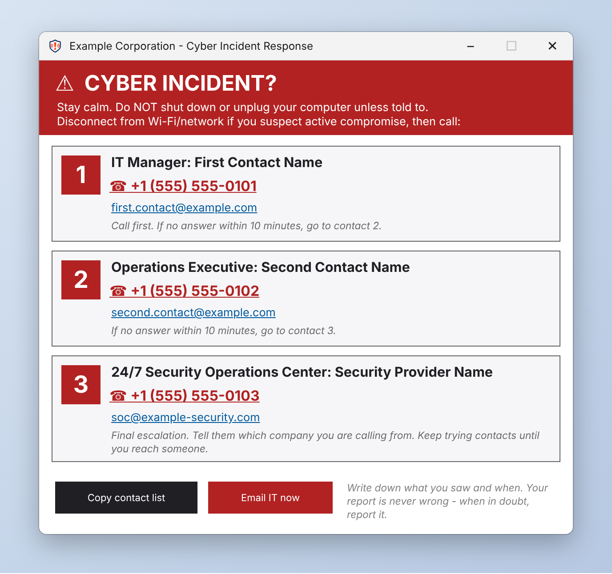
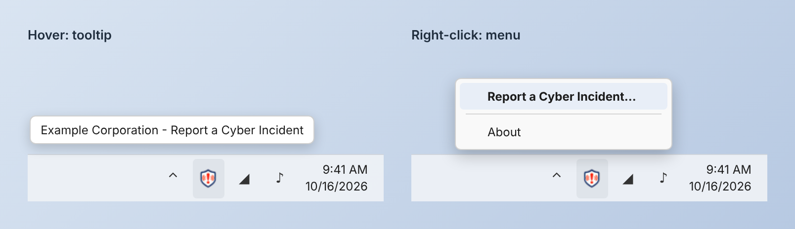
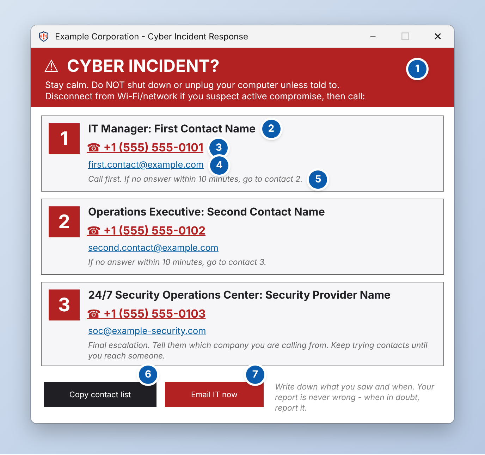
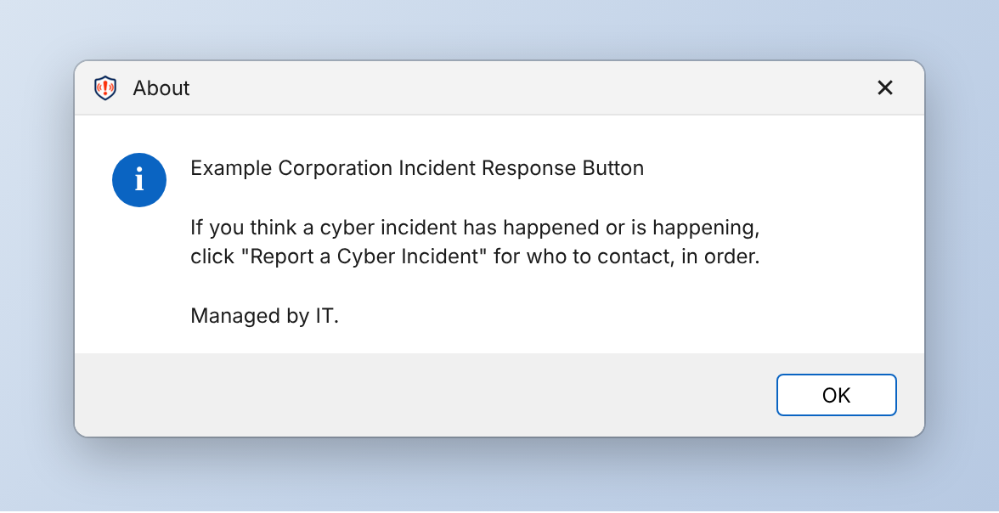

# OpenIRButton: Incident Response Button

A Windows system tray app that IT teams deploy to their workstations. During a cyber incident, any employee can click the shield icon next to the clock and see **who to call, in what order**, with click-to-call phone numbers and click-to-email addresses.

- **Built for IT and security teams.** You set the escalation chain once and push it to every endpoint. Employees don't install or configure anything.
- **Deploy it however you like.** Use Microsoft Intune, Configuration Manager, Group Policy, an RMM tool, or run one script by hand. It ships ready for **Intune**: install and uninstall scripts and a detection rule are included and documented.
- **Nothing to install on the build machine.** It compiles with the C# compiler that already ships with Windows. There's no SDK, no Visual Studio, no installer framework and no third-party library.
- **Nothing leaves the machine.** The app has no network code. It only hands phone numbers and email addresses to the phone and mail apps already on the PC.



<sub>Mockup rendered from the layout in `IncidentButton.cs` using the example data in `contacts.json`. On a real Windows PC the text uses Segoe UI.</sub>

---

## Table of contents

1. [Why it exists](#why-it-exists)
2. [What employees see](#what-employees-see)
3. [What every button does](#what-every-button-does)
4. [How it works](#how-it-works)
5. [Quick start for IT](#quick-start-for-it)
6. [What you must edit before deploying](#what-you-must-edit-before-deploying)
7. [Deploying it](#deploying-it)
8. [Updating contacts later](#updating-contacts-later)
9. [Privacy and security](#privacy-and-security)
10. [Requirements](#requirements)
11. [Repository layout](#repository-layout)
12. [FAQ](#faq)
13. [License](#license)

---

## Why it exists

During an incident the slowest step is often the human one. An employee sees something odd, isn't sure it's worth reporting, then goes looking for the right phone number while the clock runs.

This app puts the answer one click away on every workstation, with no login, no intranet page and no portal to find. The panel opens by itself saying "when in doubt, report it", which takes the guesswork out of whether to call.

It also gives you a documented control artifact. You get a persistent incident-reporting mechanism on every endpoint and a local activity log on each machine. That supports frameworks such as **NIST SP 800-171 3.6.1 / 3.6.2** (incident-handling capability and incident reporting), CMMC IR.L2-3.6.1 / 3.6.2, and similar requirements.

---

## What employees see

### 1. A shield in the notification area

The app starts automatically when anyone signs in and puts a red-and-white shield next to the clock. On Windows 11 22H2 and later it pins itself to the visible taskbar, so it isn't hidden behind the `^` overflow arrow.



- **Hovering** shows a tooltip: `<Your Organization> - Report a Cyber Incident`.
- **Left-clicking** opens the incident panel straight away.
- **Right-clicking** shows a menu with **Report a Cyber Incident...** (opens the panel) and **About**.

There is deliberately **no Exit option**. Employees can't close the app by accident, and it comes back at every sign-in.

### 2. The incident panel

The panel opens in the middle of the screen and stays on top of other windows. It has a red header with immediate instructions, a numbered card for each contact in escalation order, and two action buttons.



### 3. The About box



This is a short reminder of what the shield is for. It uses the organization name from `contacts.json`.

---

## What every button does

The numbers match the annotated screenshot above.

| # | Element | What happens when it's used |
|---|---|---|
| 1 | **Red header** | Fixed instructions: stay calm, don't shut down or unplug the computer (that destroys evidence), and disconnect from the network if compromise looks active. The wording lives in `IncidentButton.cs` (see [CUSTOMIZATION.md](docs/CUSTOMIZATION.md)). |
| 2 | **Order badge + "Role: Name"** | Shows each contact's position in the escalation chain. Cards appear in the **same order as in `contacts.json`**. The number in the red square is just the `order` text from the file. |
| 3 | **Phone number** (red link) | Opens the PC's default calling app (Microsoft Teams, Phone Link, Zoom Phone, a softphone, etc.) with the number filled in. Before dialing, the app strips everything except digits and `+`. If nothing on the PC handles phone links, the number is **copied to the clipboard** instead. |
| 4 | **Email address** (blue link) | Opens a new email to that contact in the default mail app (Outlook, etc.). |
| 5 | **Note** (grey italic) | Your instructions for this step, for example "If no answer within 10 minutes, go to contact 2." Long notes wrap, and the card grows to fit. |
| 6 | **Copy contact list** | Copies the whole chain to the clipboard as plain text, one contact per line (`1. IT Manager - First Contact Name - +1 (555) 555-0101 - first.contact@example.com`). The button changes to **Copied!**. This helps when the employee needs to call from a mobile phone or paste the list into a chat. |
| 7 | **Email IT now** | Opens a pre-filled email **to contact #1's email address**, with subject `POSSIBLE CYBER INCIDENT - <COMPUTER NAME>` and a body containing the user's name, computer name, and blank `Time noticed:` / `What I saw:` lines to fill in. **Make sure contact #1's email is monitored.** |
| — | **Minimize / Close** (title bar) | Hides the panel. The shield stays in the tray. Clicking the shield again reopens the panel and re-reads `contacts.json`. |

Every open and click is written to a local activity log (see [Privacy and security](#privacy-and-security)).

---

## How it works

```
                    Build machine                                   Every workstation
 ┌───────────────────────────────────────────┐        ┌──────────────────────────────────────────────────┐
 │ contacts.json  ← you edit this            │        │ C:\Program Files\IncidentButton\                 │
 │ IncidentButton.cs                         │ Intune │     IncidentButton.exe                           │
 │ app.ico                                   │  RMM   │     version.txt   ← Intune detection rule reads  │
 │ Build.ps1  → IncidentButton.exe           │  GPO   │ C:\ProgramData\IncidentButton\                   │
 │ install.ps1 / uninstall.ps1               │ ─────► │     contacts.json ← app reads on every open      │
 └───────────────────────────────────────────┘        │ HKLM\...\Run\IncidentButton ← starts at sign-in  │
                                                      │ %LOCALAPPDATA%\IncidentButton\activity.log       │
                                                      └──────────────────────────────────────────────────┘
```

1. **`install.ps1`** runs as SYSTEM (Intune does this for you). It:
   - copies `IncidentButton.exe` into `C:\Program Files\IncidentButton\`. If no `.exe` was packaged, it compiles one on the spot from `IncidentButton.cs`;
   - copies `contacts.json` to `C:\ProgramData\IncidentButton\`;
   - adds an `HKLM\...\Run` entry so the app starts for **every user** at sign-in;
   - writes `version.txt` (what the Intune detection rule checks);
   - launches the app for whoever is signed in right now, so nobody has to reboot.
2. **At sign-in** Windows starts the app in the user's session. Only one copy runs per user session.
3. **Each time the panel opens** the app reads `C:\ProgramData\IncidentButton\contacts.json`. That's why you can change contacts across the fleet without reinstalling anything.
4. **If that file is missing or unreadable**, the app falls back to the built-in example contacts compiled into the `.exe`. If employees ever see "Example Corporation", the file didn't arrive or is broken.

---

## Quick start for IT

> **Full step-by-step instructions, including Intune packaging, detection rules, testing and troubleshooting, are in [SETUP-GUIDE.md](SETUP-GUIDE.md).** This is the short version.

On a Windows 10/11 PC:

```powershell
# 1. Get the code (or use "Code → Download ZIP" on GitHub and extract it)
git clone https://github.com/CosmoJM/OpenIRButton.git
cd OpenIRButton

# 2. Put your organization and contacts into contacts.json (Notepad is fine)
notepad .\contacts.json

# 3. Check the file is valid. No output means it's fine; red text means fix it.
Get-Content .\contacts.json -Raw | ConvertFrom-Json | Out-Null

# 4. Build and launch it to see it on your own screen
powershell -ExecutionPolicy Bypass -File .\Build.ps1 -Run
```

Click the shield near the clock and check every name, number and email. Then follow [SETUP-GUIDE.md](SETUP-GUIDE.md) to package and deploy it.

> **Testing on your own PC:** when you run the `.exe` straight from the build folder, the app reads `C:\ProgramData\IncidentButton\contacts.json`, not the copy next to the `.exe`. Until you've run `install.ps1` once, you'll see the **example** contacts. To preview your own contacts without installing, copy the file there from an **elevated** PowerShell:
> ```powershell
> New-Item -ItemType Directory -Force "$env:ProgramData\IncidentButton" | Out-Null
> Copy-Item .\contacts.json "$env:ProgramData\IncidentButton\contacts.json" -Force
> ```

---

## What you must edit before deploying

| What | Where | Required? |
|---|---|---|
| Organization name and escalation contacts | `contacts.json` | **Yes. This is the only required edit.** |
| Package version (for Intune upgrades) | `$Version = '1.0.0'` at the top of `install.ps1` | Only when you ship a new build |
| Company name in the `.exe` file properties | `AssemblyCompany("Example Corporation")` near the top of `IncidentButton.cs` | Optional |
| Fallback contacts compiled into the `.exe` | `FallbackOrgName` and `Fallback()` in `IncidentButton.cs` | Optional, but recommended (see below) |
| Header wording, footer tip, colors | `IncidentButton.cs` | Optional |
| Tray icon | Replace `app.ico` | Optional |

Every one of these is explained line by line in **[docs/CUSTOMIZATION.md](docs/CUSTOMIZATION.md)**.

### Filling in `contacts.json`

```json
{
  "organization": "Contoso Ltd",

  "contacts": [
    {
      "order": "1",
      "role": "IT Manager",
      "name": "Jordan Smith",
      "phone": "+1 (555) 555-0101",
      "email": "it-urgent@contoso.com",
      "note": "Call first. If no answer within 10 minutes, go to contact 2."
    },
    {
      "order": "2",
      "role": "Operations Director",
      "name": "Sam Lee",
      "phone": "+1 (555) 555-0102",
      "email": "sam.lee@contoso.com",
      "note": "If no answer within 10 minutes, go to contact 3."
    },
    {
      "order": "3",
      "role": "24/7 Security Operations Center",
      "name": "Fabrikam MDR",
      "phone": "+1 (555) 555-0199",
      "email": "soc@fabrikam-mdr.example",
      "note": "Final escalation. Tell them you are calling from Contoso. Keep trying until you reach someone."
    }
  ]
}
```

Rules that keep it working:

- **Every field is text in double quotes**, including `order` (`"1"`, not `1`).
- **A comma goes between contacts** (`},` then `{`) but **not after the last one** (`}` then `]`).
- **Contact #1 receives the "Email IT now" message.** Use a monitored mailbox or distribution list.
- **Contacts appear in the order they're listed in the file**, not sorted by `order`.
- **A contact with an empty `name` is skipped.**
- **Don't use `{` or `}` inside any text value.** The app's lightweight reader uses braces to find each contact.
- **Keep `role` + `name` short** (about 45 characters combined). That line doesn't wrap and a very long one runs past the edge of the card. Put the extra detail in `note`.
- **Keep `order` to one or two characters**, because it sits in a small square badge.
- **Use as many contacts as you need.** The window grows to fit and scrolls if it would be taller than the screen.
- **Save the file as UTF-8** (Notepad: *File → Save As → Encoding: UTF-8*) if you use accented characters.
- The `_README` line at the top is ignored by the app. Keep it or delete it.

### ⚠ Before you push to GitHub

If your copy of this repository is **public**, don't commit your real `contacts.json`. Phone numbers and names in a public repo are visible to everyone, attackers included. Either:

- edit `contacts.json` **only on the machine where you build and package**, and don't commit it; or
- keep your organization's copy in a **private** fork or repository.

Never commit the compiled `IncidentButton.exe` or `.intunewin` packages; `.gitignore` already excludes them. Build from source, or attach signed builds to a GitHub Release.

---

## Deploying it

| Tool | How | Guide |
|---|---|---|
| **Microsoft Intune** (recommended) | Win32 app: package with `IntuneWinAppUtil`, install as System, file detection on `version.txt` | [SETUP-GUIDE.md → Steps 3–5](SETUP-GUIDE.md#step-3--package-it-for-intune) |
| **Configuration Manager (SCCM/MECM)** | Script installer: same install/uninstall commands and detection rule as Intune | [SETUP-GUIDE.md → Other tools](SETUP-GUIDE.md#deploying-without-intune) |
| **RMM** (NinjaOne, Datto, ConnectWise, N-able, Kaseya, …) | Copy the folder to the endpoint and run `install.ps1` as SYSTEM | [SETUP-GUIDE.md → Other tools](SETUP-GUIDE.md#deploying-without-intune) |
| **Group Policy** | Computer startup script that runs `install.ps1` from a share | [SETUP-GUIDE.md → Other tools](SETUP-GUIDE.md#deploying-without-intune) |
| **By hand** | Elevated PowerShell: `.\install.ps1` | [SETUP-GUIDE.md → Other tools](SETUP-GUIDE.md#deploying-without-intune) |

Removal is the same with `uninstall.ps1`.

---

## Updating contacts later

You don't need to rebuild or reinstall. The app re-reads `C:\ProgramData\IncidentButton\contacts.json` every time the panel opens, so pushing a new file (for example with an Intune **Platform script**) takes effect immediately. A ready-to-use script is in [SETUP-GUIDE.md](SETUP-GUIDE.md#changing-contacts-later--no-rebuild-needed).

---

## Privacy and security

- **No network access.** The code contains no HTTP, sockets or telemetry. Phone and email links are handed to Windows (`tel:` / `mailto:`) and handled by whatever apps the user already has.
- **Runs as the signed-in user**, not as an administrator. Only the installer needs admin/SYSTEM rights.
- **The only things it writes:**
  - `%LOCALAPPDATA%\IncidentButton\activity.log`, a per-user text log of app starts, panel opens and which contact was clicked (timestamp + username + action). Useful to show the control is in place and used, or when diagnosing a single PC.
  - `HKCU\Control Panel\NotifyIconSettings\<id>\IsPromoted = 1`, the per-user setting that pins its own tray icon to the taskbar on Windows 11. It only ever changes the entry belonging to its own `.exe`.
- **Contacts are readable by every user on the PC.** That's the point, but don't put anything in `contacts.json` that employees shouldn't see.
- **Code signing:** if your environment uses WDAC/AppLocker or you want to avoid SmartScreen prompts, sign `IncidentButton.exe` with your organization's code-signing certificate after building and before packaging.

---

## Requirements

- Windows 10 or 11, 64-bit.
- .NET Framework 4.x. It's built into every supported Windows 10/11 release, so there's nothing to install.
- Pinning to the taskbar needs **Windows 11 22H2 or later**. On older builds the app works the same, but the icon may sit in the `^` overflow area until the user drags it out.
- A calling app registered for `tel:` links (Teams, Phone Link, etc.) if you want click-to-call. Without one, clicking a number copies it to the clipboard.

---

## Repository layout

| File | Purpose |
|---|---|
| `contacts.json` | Organization name and escalation contacts. **The only file most people edit.** |
| `IncidentButton.cs` | The whole application: a single-file C# WinForms program |
| `app.ico` | Tray and window icon. Replace it with your own. |
| `Build.ps1` | Compiles `IncidentButton.exe` (`-Run` also launches it) |
| `install.ps1` | Deployment script; Intune/RMM runs this as SYSTEM |
| `uninstall.ps1` | Removal script |
| `SETUP-GUIDE.md` | Step-by-step build, packaging, deployment, testing and troubleshooting |
| `docs/CUSTOMIZATION.md` | Every optional change: wording, colors, icon, fallback contacts |
| `docs/images/` | Screenshots used in the docs |

---

## FAQ

**Employees see "Example Corporation" and fake contacts. Why?**
The app couldn't read `C:\ProgramData\IncidentButton\contacts.json`. Either it isn't there or it has a syntax error. Check it with `Get-Content "C:\ProgramData\IncidentButton\contacts.json" -Raw | ConvertFrom-Json`. Setting your real details in the code's fallback values as well (see [CUSTOMIZATION.md](docs/CUSTOMIZATION.md#fallback-contacts)) keeps this from ever showing the wrong people.

**Do I need to rebuild when a phone number changes?**
No. Push the new `contacts.json` to `C:\ProgramData\IncidentButton\` and it takes effect the next time anyone opens the panel.

**Can employees close it?**
They can close the panel, but not the tray app; there's no Exit menu. Ending it in Task Manager only lasts until the next sign-in.

**Does it work on Remote Desktop / multi-user machines?**
Yes. Every signed-in session gets its own copy of the tray icon and its own activity log.

**Does it work without Intune?**
Yes. Anything that can run a PowerShell script as SYSTEM can deploy it. See [Deploying it](#deploying-it).

**Can I change the red color or the header text?**
Yes, in `IncidentButton.cs`. See [docs/CUSTOMIZATION.md](docs/CUSTOMIZATION.md).

---

## License

MIT. See [LICENSE](LICENSE).
